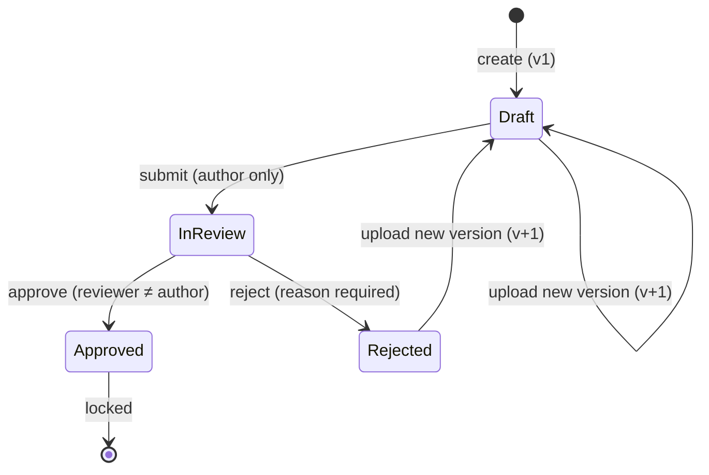

# DocFlow API


A **document versioning and approval workflow** REST API built with **ASP.NET Core 8, Entity Framework Core and PostgreSQL**.

Teams create projects, upload documents, revise them as new versions, and send them through a review cycle
(**Draft → In Review → Approved / Rejected**). Every action is written to an **audit trail**, approved documents are
**locked**, and nobody can approve their own work.

---

## Features

- **JWT authentication** with **role-based authorization** (Admin, Author, Reviewer)
- **Document lifecycle state machine** with enforced transitions
- **Version history** — each revision is stored with a change summary and uploader
- **Segregation of duties** — authors cannot review their own documents
- **Audit trail** — every state change is logged in the same transaction as the change itself
- **Filtering, search and pagination** on document listings
- **Consistent error responses** using RFC 7807 `ProblemDetails` via global exception middleware
- **Swagger / OpenAPI** with a built-in "Authorize" button for JWTs
- **Unit tests** (xUnit + EF Core InMemory) covering the workflow rules
- **Docker Compose** setup (API + PostgreSQL) and **GitHub Actions CI**

## Tech stack

| Area | Technology |
|---|---|
| Framework | .NET 8, ASP.NET Core Web API |
| Data access | Entity Framework Core 8, Npgsql |
| Database | PostgreSQL 16 |
| Auth | JWT Bearer, BCrypt password hashing |
| Docs | Swagger (Swashbuckle) |
| Tests | xUnit, EF Core InMemory |
| DevOps | Docker, Docker Compose, GitHub Actions |

## Architecture

```
Controllers  →  Services (business rules)  →  Repositories  →  EF Core DbContext  →  PostgreSQL
     ↑               ↑
   DTOs        Unit of Work (one SaveChanges per use case = atomic change + audit entry)
```

```
src/DocFlow.Api
├── Controllers/      HTTP endpoints, role checks, no business logic
├── Services/         Workflow rules, auth, token creation
├── Repositories/     Data access behind interfaces (easy to test / swap)
├── Data/             AppDbContext, Fluent API configuration, IUnitOfWork
├── Domain/           Entities and enums
├── DTOs/             Request/response contracts + explicit mapping
├── Middleware/       Global exception → ProblemDetails
└── Common/           Custom exceptions, paging, settings
tests/DocFlow.Tests   xUnit tests for DocumentService
```

## Document workflow



## API endpoints

| Method | Route | Role | Description |
|---|---|---|---|
| POST | `/api/auth/register` | anyone | Register as Author or Reviewer |
| POST | `/api/auth/login` | anyone | Get a JWT |
| GET | `/api/projects` | any user | List projects with document counts |
| POST | `/api/projects` | Admin, Author | Create a project |
| POST | `/api/projects/{projectId}/documents` | Admin, Author | Create a document (v1, Draft) |
| GET | `/api/documents?projectId=&status=&search=&page=&pageSize=` | any user | Search with paging |
| GET | `/api/documents/{id}` | any user | Document with version history |
| GET | `/api/documents/{id}/history` | any user | Audit trail |
| POST | `/api/documents/{id}/versions` | Admin, Author | Upload a new version |
| POST | `/api/documents/{id}/submit` | Admin, Author | Submit for review |
| POST | `/api/documents/{id}/approve` | Admin, Reviewer | Approve |
| POST | `/api/documents/{id}/reject` | Admin, Reviewer | Reject (comment required) |
| GET | `/health` | anyone | Health check |

Error responses (example):

```json
{
  "status": 409,
  "title": "Business rule violation",
  "detail": "Cannot approve: document is Draft, expected InReview.",
  "instance": "/api/documents/7/approve",
  "traceId": "0HN..."
}
```

## Running locally

### Option A — Docker (easiest)

```bash
docker compose up --build
```

Open http://localhost:8080/swagger

### Option B — .NET SDK + local PostgreSQL

```bash
# 1. Start PostgreSQL (or: docker compose up db)
# 2. Run the API
cd src/DocFlow.Api
dotnet run
```

Open http://localhost:5080/swagger. Pending migrations are applied automatically in Development.

### Try the workflow in Swagger

1. `POST /api/auth/register` — create an **Author** (`"role": "Author"`) and a **Reviewer** (`"role": "Reviewer"`).
2. Log in as the Author, click **Authorize**, paste the token.
3. Create a project, then a document in it, then `submit` it.
4. Log in as the Reviewer, re-authorize, and `approve` or `reject` it.
5. Check `GET /api/documents/{id}/history` to see the audit trail.

### Run the tests

```bash
dotnet test tests/DocFlow.Tests
```

## Design decisions

- **Business rules live in the service layer**, not controllers, so they are unit-testable without HTTP.
- **Unit of Work** — each use case calls `SaveChangesAsync` once, so a status change and its audit entry are committed
  together or not at all.
- **Enums stored as strings** in PostgreSQL so the data is readable in SQL and safe if enum order changes.
- **`TimeProvider`** is injected instead of calling `DateTime.UtcNow` directly, which keeps time-based logic testable.
- **Manual DTO mapping** — explicit, compile-time checked, no reflection.
- **Same error for unknown email and wrong password** to avoid user enumeration.

## Possible next steps

- Store actual files (local disk / S3 / Azure Blob) with SHA-256 checksums
- Optimistic concurrency using PostgreSQL `xmin`
- Integration tests with `WebApplicationFactory` and Testcontainers
- Refresh tokens and email notifications to reviewers

If your PostgreSQL password is different from the default, set your own connection string with user secrets (it is not committed to git):

    dotnet user-secrets set "ConnectionStrings:Default" "Host=localhost;Port=5432;Database=docflow;Username=postgres;Password=YOUR_PASSWORD"
